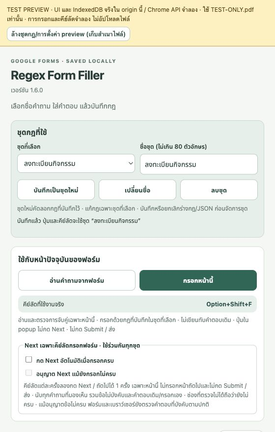

# Regex Form Filler

ส่วนขยายสำหรับ Opera และ Chrome ช่วยกรอก Google Forms จากชื่อคำถาม มี UI ภาษาไทยสำหรับสร้างกฎแบบตรงชื่อ มีคำที่ระบุ หรือ Regex รองรับข้อความ ตัวเลือก วันที่ พ.ศ./ค.ศ. และไฟล์แนบในรูปแบบที่รองรับ

**เวอร์ชัน 1.6.1** ปรับเฉพาะไอคอนให้ใหญ่และชัดขึ้นบนแถบเครื่องมือ · รุ่นนี้ยังไม่ได้ส่ง Store

ประวัติ **v1.5.6** · Chrome Web Store: ส่งแล้วและรอรีวิว ณ 14 ตุลาคม 2026 · Opera Add-ons: ยังไม่ได้ส่ง ณ วันดังกล่าว

[ดาวน์โหลด v1.6.1](https://github.com/indevizible/regex-form-filler/releases/tag/v1.6.1) · [Privacy policy](https://indevizible.github.io/regex-form-filler-privacy/) · [คู่มือฉบับเต็ม](outputs/regex-form-filler/README.md)



## ติดตั้งจาก ZIP

1. ดาวน์โหลด `regex-form-filler-opera-v1.6.1.zip` จาก Releases แล้วแตกไฟล์
2. เปิด `opera://extensions` หรือ `chrome://extensions` และเปิด Developer mode
3. กด Load unpacked แล้วเลือกโฟลเดอร์ `regex-form-filler` ที่มี `manifest.json`
4. เปิด Google Forms หน้าตอบ กดส่วนขยายเพื่อเพิ่มกฎ และกดกรอกหน้านี้

คีย์ลัดเริ่มต้น: **Option+Shift+F** บน macOS และ **Alt+Shift+F** บน Windows/Linux หากมีคีย์ลัดเดิมหรือชนกับเบราว์เซอร์ ให้ตั้งในหน้า Extension keyboard shortcuts

## อัปเดตและข้อมูลที่เก็บไว้

รุ่น 1.6.1 ขยายรูปเอกสารสีมิ้นต์พร้อมเครื่องหมายถูกภายในไอคอนเดิม โดยลดพื้นที่ว่างรอบภาพ ไม่มีการเปลี่ยนฟีเจอร์ พฤติกรรม สิทธิ์ คีย์ลัด หรือข้อมูลที่เก็บไว้

สำหรับ Load unpacked ให้คัดลอกไฟล์ใหม่ทับโฟลเดอร์เดิมแล้วกด Reload โดยไม่ถอนส่วนขยาย รุ่น 1.6.0 แสดงกฎเดิมเป็น **ค่าเริ่มต้น** พร้อมข้อมูลอ้างอิงไฟล์เดิม และบันทึกรูปแบบชุดกฎเมื่อแก้ไขครั้งแรก

เลือกชุดจาก dropdown พิมพ์ชื่อแล้วกด **บันทึกเป็นชุดใหม่** เพื่อคัดลอกกฎที่บันทึกไว้ หรือ **เปลี่ยนชื่อ** / **ลบชุด** (ต้องยืนยันและเหลืออย่างน้อยหนึ่งชุด) การแก้กฎและ JSON มีผลเฉพาะชุดที่เลือก ต้องบันทึกหรือยกเลิกร่างก่อนจัดการชุด ปุ่มกรอกและคีย์ลัดใช้ชุดที่เลือกเมื่อเริ่มรัน ส่วนตัวเลือก Next ใช้ร่วมกันทุกชุด

การลบแสดงชื่อชุดพร้อมปุ่ม **ยืนยันลบชุด** / **ยกเลิก** ในแผงชุดกฎ ระหว่างรอยืนยันจะพักการแก้ไขและเลือกชุด ข้อความสำเร็จหรือข้อผิดพลาดจะแสดงข้างปุ่มทันที

JSON นำเข้า/ส่งออกยังเป็น array ของกฎ **เฉพาะชุดที่เลือก** ไม่รวมชื่อชุด ชุดอื่น หรือการตั้งค่า Next การย้ายไป Store หรือเปลี่ยน extension ID/โปรไฟล์อาจใช้พื้นที่เก็บข้อมูลคนละชุด ให้ export/import แต่ละชุดและเลือกไฟล์แนบใหม่ JSON ไม่บรรจุเนื้อไฟล์แนบ

ส่วนขยายเก็บกฎและสำเนาไฟล์ในเครื่อง ไม่มีระบบ sync/backend ของผู้พัฒนา เมื่อสั่งกรอกหรือแนบไฟล์ ข้อมูลอาจถูกส่งไปยัง Google และเจ้าของฟอร์ม รวมถึงการบันทึกร่างอัตโนมัติ ส่วนขยายไม่กด Submit โปรดตรวจคำตอบก่อนส่ง

## ซอร์สและการพัฒนา

ไม่มีขั้นตอน compile หรือ dependency ที่ต้องติดตั้ง ไฟล์ HTML/CSS/JavaScript ใน `outputs/regex-form-filler/` คือซอร์ส 1.6.1 สำหรับ Load unpacked และการทดสอบ รุ่นนี้ยังไม่ได้ส่ง Store

- `outputs/regex-form-filler/` — ส่วนขยายและตัวอย่างกฎสังเคราะห์
- `work/regex-form-filler-tests/` — ชุดทดสอบและหน้า preview เฉพาะพัฒนา
- `assets/` — ไอคอนและภาพตัวอย่างจากข้อมูลสมมติ

ใช้ Node.js 22+ และ Python 3.9+ จาก repository root:

```sh
node --test work/regex-form-filler-tests/*.test.mjs
python3 work/regex-form-filler-tests/preview-server.py --self-test
```

[วิธีเปิด preview และ fixtures](work/regex-form-filler-tests/README.md)

## ไฟล์ Release v1.6.1

- `regex-form-filler-opera-v1.6.1.zip` — แตกไฟล์แล้วติดตั้งแบบ Load unpacked ได้ทั้ง Opera และ Chrome
- `regex-form-filler-1.6.1-store.zip` — แพ็กเกจ 18 runtime files สำหรับส่ง Store มี manifest ที่ราก ZIP
- `SHA256SUMS.txt` — ค่า SHA-256 สำหรับตรวจไฟล์ดาวน์โหลด

แพ็กเกจ Store ใช้ไฟล์ runtime จาก `outputs/regex-form-filler/` การทดสอบอัตโนมัติไม่แทนการทดสอบส่วนขยายที่ติดตั้งจริง และ Google Forms อาจเปลี่ยนหน้าตาหรือโครงสร้างที่ส่วนขยายรองรับ

ติดต่อ: [jadedragon17650@gmail.com](mailto:jadedragon17650@gmail.com)
